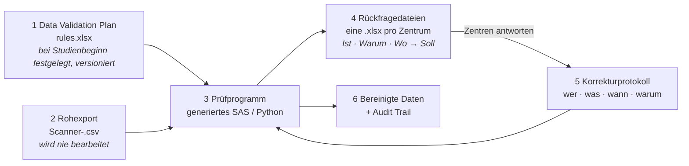

# crf-rule-engine

[English](README.md) · **Deutsch**

**Plausibilitätsprüfungen für Studien mit Papier-CRFs: Die Regeln werden in Excel statt im Code gepflegt, Rückfragen gehen an die Studienzentren, und jede Änderung ist lückenlos dokumentiert.**

**▶ Live-App: [carpetcrawler78.github.io/crf-rule-engine](https://carpetcrawler78.github.io/crf-rule-engine/)** – auf *Load fictional demo study* klicken. Streamlit läuft vollständig im Browser (stlite); es wird nichts hochgeladen, weil Python direkt in der Seite ausgeführt wird. Der erste Start dauert etwa 20 Sekunden.

> **Hintergrund.** Ursprünglich habe ich das als SAS-Tool für die Papierfragebögen einer multizentrischen klinischen Studie entwickelt (2025). Dieses Repository setzt die Idee neu um: mit einer fiktiven Studie, synthetischen Daten und neuem Code. Es enthält weder Code noch Daten oder Variablendefinitionen der Originalstudie.

---

## Der Bereinigungszyklus

In einer papierbasierten Studie werden die Fragebögen gescannt; der Scanner erzeugt pro Bogen eine Textzeile. Bereinigt werden die Daten mit einem festen Satz von Artefakten, für die jeweils klar ist, wer sie pflegt:



| # | Artefakt | Was es ist | Ändert sich, wenn |
|---|---|---|---|
| 1 | **Data Validation Plan** (`rules/*.xlsx`) | Eine Zeile pro CRF-Feld: Formatcode, Regel (SAS-Syntax, `#` = dieses Feld), Meldung. | Bei Studienbeginn festgelegt; jede Änderung wird versioniert. |
| 2 | **Rohexport** (`data/*.csv`) | Die Ausgabe des Scanners. | Wird nie von Hand bearbeitet. |
| 3 | **Prüfprogramm** (`sas/*.sas` oder die Python-Engine) | Aus 1 generiert. Niemand schreibt es von Hand. | Nur wenn sich 1 ändert. |
| 4 | **Rückfragedateien** (`queries_<site>.xlsx`) | Pro Zentrum: aktueller Wert (*Ist*), Problem (*Warum*), Frage und Feld (*Wo*). Das Zentrum trägt den korrekten Wert (*Soll*) und die Quelle ein. Jedes Zentrum sieht nur seine eigenen Teilnehmenden. | Nach jedem Prüflauf. |
| 5 | **Korrekturprotokoll** (`corrections/*.xlsx`) | Jede Änderung als eigene Zeile: ID, Feld, alter Wert, neuer Wert, Grund, Quelle (Rückfrage oder offensichtliche Korrektur), Datum, Bearbeiter. | Laufend während der Studie. |
| 6 | **Audit Trail** | Welche Korrekturen angewendet und welche abgelehnt wurden. | Bei jedem Lauf. |

**Bereinigte Daten = Rohexport + Korrekturprotokoll.** Der Rohexport wird nie überschrieben. So lässt sich jeder Wert in der Auswertung bis zum gescannten Bogen und zu der Person zurückverfolgen, die ihn geändert hat.

Eine Korrektur wird nur angewendet, wenn die Daten noch ihren `old_value` enthalten. Andernfalls wird sie als *Konflikt* abgelehnt. So kann eine Antwort, die sich auf einen älteren Scan bezieht, keine neueren Daten überschreiben.

## Das Regelblatt

| variable | format | rule | message |
|---|---|---|---|
| `fu12_month` | `+"0"N(0-2)` | `# >= 1 and # <= 12` | Month missing or not between 1 and 12 |
| `fu12_health` | `+"0"N(1)` | `# in (1 2 3 4 5 6 7)` | Health rating missing, out of range or several boxes ticked (8) |
| `fu12_hosp` | `+"0"N(1)` | `(# = 0 and fu12_hosp_m = . and fu12_hosp_y = .) or # = 1` | Hospital stay missing, or 'no' although a date is given |
| `scan_date` | `YYMMDD` | `not missing(#) and # >= mdy(fu12_month, fu12_day, fu12_year)` | Scan date missing or before the date of completion |

Eine Regel beschreibt einen **gültigen** Wert. Derselbe Regeltext wird an zwei Stellen verwendet:

* **SAS:** Die Regel wird unverändert in das generierte Programm eingesetzt.
* **Python:** Ein kleiner Parser mit fester Liste erlaubter Ausdrücke übersetzt sie. Er bildet das SAS-Verhalten nach, auf das es bei diesen Prüfungen ankommt: Ein fehlender Zahlenwert (`.`) ist kleiner als jeder andere Wert, und `IN (8 88)` akzeptiert eine durch Leerzeichen getrennte Liste. Ein Regelblatt kann deshalb keinen beliebigen Code ausführen.

## Schnellstart

```bash
pip install -e ".[dev]"

crf-rules lint    rules/demo_fu12_rules.xlsx
crf-rules check   rules/demo_fu12_rules.xlsx data/demo_fu12_raw.csv \
                  -c corrections/demo_fu12_corrections_log.xlsx -o output/
crf-rules gen-sas rules/demo_fu12_rules.xlsx -o sas/edit_checks_demo_fu12.sas

streamlit run app/streamlit_app.py      # die App, lokal
python app/build_stlite.py              # docs/index.html neu erzeugen (Browser-Version)
pytest
```

`output/` enthält danach:

* `cleaned.csv`
* `audit_trail.csv`
* `plausibility_report.xlsx` mit den Blättern summary, findings, audit_trail und rule_problems
* `queries/queries_<site>_<date>.xlsx`

**Für SAS-Anwender:** `sas/edit_checks_demo_fu12.sas` ist ein schlichtes Programm in fünf kommentierten Schritten. Oben drei Pfade setzen und ausführen. Siehe [sas/README.md](sas/README.md) (englisch).

## Demo-Studie

`ACTIVE-65` ist **fiktiv**: ein Follow-up-Fragebogen nach 12 Monaten für eine erfundene Bewegungsstudie mit Erwachsenen ab 65 Jahren in 4 Zentren. Er umfasst 26 Felder und 24 Regeln. `scripts/make_demo_data.py` erzeugt mit festem Seed 300 synthetische Bögen und baut gezielt Fehler in einige davon ein:

* mehrere Kästchen angekreuzt
* 31. April
* Alter 58 in einer Studie für Menschen ab 65
* „kein Krankenhausaufenthalt“, aber ein Datum angegeben
* „7O“ in einem Zahlenfeld
* Scandatum vor dem Ausfülldatum
* IDs außerhalb des vergebenen Bereichs
* …

Rund 60 % der daraus entstehenden Rückfragen sind im Korrekturprotokoll „beantwortet“. Das Protokoll enthält außerdem absichtlich eine veraltete Antwort.

Die Tests prüfen:

* Ohne Protokoll meldet die Engine **genau** die eingebauten Fehler: nichts wird übersehen, kein Fehlalarm.
* Mit Protokoll bleiben genau die unbeantworteten übrig.
* Die veraltete Antwort wird abgelehnt und lässt die Daten unverändert.
* Der Rohexport wird nie verändert.
* Die Rückfragedatei jedes Zentrums enthält nur dessen eigene Teilnehmende.

## Aufbau des Repositorys

```
rules/         Data Validation Plan der Demo-Studie
data/          synthetischer Rohexport + Referenzliste der eingebauten Fehler
corrections/   Korrekturprotokoll (beantwortete Rückfragen, offensichtliche Korrekturen)
src/crf_rules/ Formatparser, Regelübersetzer, Engine, SAS-Generator, CLI
sas/           generiertes SAS-Prüfprogramm + Kurzanleitung
app/           Streamlit-App und das stlite-Build-Skript
docs/          index.html = die App im Browser (GitHub Pages)
tests/         Unit-, End-to-End- und App-Tests
_private/      nicht in Git – nur lokales Referenzmaterial
```

## Grenzen

* Der Regelparser deckt die Teilmenge von SAS ab, die Plausibilitätsregeln verwenden:
  * Vergleiche, `and`/`or`/`not`, `in`/`not in` und Arithmetik
  * `missing`, `coalesce`, `mdy`, `today`, `year`, `month`, `day`, `prxmatch`, `length`, `upcase`, `lowcase` und `strip`
* Der Rohexport muss die Felder in derselben Reihenfolge enthalten wie das Regelblatt.
* Das SAS-Programm wird von den Tests inhaltlich geprüft, aber nicht in der CI ausgeführt, weil dort keine SAS-Lizenz vorhanden ist.

## Lizenz

MIT
