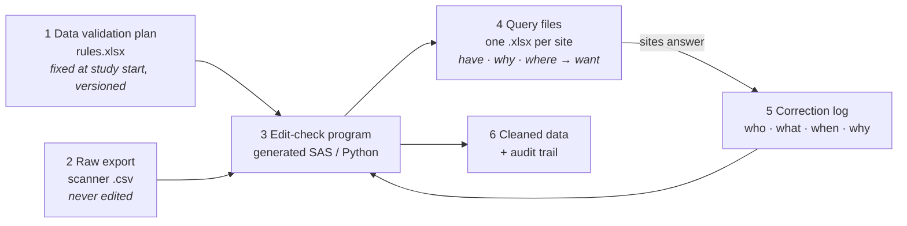

# crf-rule-engine

**English** · [Deutsch](README.de.md)

**Plausibility checks for paper-CRF studies, maintained in Excel instead of code, with queries to sites and a full audit trail.**

**▶ Live app: [carpetcrawler78.github.io/crf-rule-engine](https://carpetcrawler78.github.io/crf-rule-engine/)** – click *Load fictional demo study*. Streamlit runs entirely in your browser (stlite); nothing is uploaded, because Python runs inside the page. The first start takes about 20 s.

> **Background.** I first built this as a SAS tool for the paper questionnaires of a multicentre clinical study (2025). This repository is a fresh re-implementation of the idea: a fictional study, synthetic data, and new code. It contains no original study code, data or variable definitions.

---

## The cleaning cycle

In a paper-based study, the questionnaires are scanned and the scanner produces one text line per form. The data are cleaned with a fixed set of artifacts, each with a clear owner:



| # | Artifact | What it is | Changes when |
|---|---|---|---|
| 1 | **Data validation plan** (`rules/*.xlsx`) | One row per CRF field: format code, rule (SAS syntax, `#` = this field), message. | Defined at study start; every change is versioned. |
| 2 | **Raw export** (`data/*.csv`) | The scanner output. | Never edited by hand. |
| 3 | **Edit-check program** (`sas/*.sas`, or the Python engine) | Generated from 1. Nobody writes it by hand. | Only when 1 changes. |
| 4 | **Query files** (`queries_<site>.xlsx`) | Per site: current value (*have*), problem (*why*), question and field (*where*). The site fills in the correct value (*want*) and the source. Each site sees only its own participants. | After every check run. |
| 5 | **Correction log** (`corrections/*.xlsx`) | Every change as a row: ID, field, old value, new value, reason, source (query or self-evident correction), date, who. | Continuously during the study. |
| 6 | **Audit trail** | Which corrections were applied and which were rejected. | Every run. |

**Cleaned data = raw export + correction log.** The raw export is never overwritten, so every value in the analysis can be traced back to the scanned form and to the person who changed it.

A correction is applied only if the data still contain its `old_value`. Otherwise it is rejected as a *conflict*. This stops an answer that was written for an older scan from overwriting newer data.

## The rules sheet

| variable | format | rule | message |
|---|---|---|---|
| `fu12_month` | `+"0"N(0-2)` | `# >= 1 and # <= 12` | Month missing or not between 1 and 12 |
| `fu12_health` | `+"0"N(1)` | `# in (1 2 3 4 5 6 7)` | Health rating missing, out of range or several boxes ticked (8) |
| `fu12_hosp` | `+"0"N(1)` | `(# = 0 and fu12_hosp_m = . and fu12_hosp_y = .) or # = 1` | Hospital stay missing, or 'no' although a date is given |
| `scan_date` | `YYMMDD` | `not missing(#) and # >= mdy(fu12_month, fu12_day, fu12_year)` | Scan date missing or before the date of completion |

A rule describes a **good** value. The same rule text is used in two places:

* **SAS:** the rule is pasted into the generated program.
* **Python:** a small, whitelisted parser translates it. The parser reproduces the SAS behaviour that matters for these checks: a missing number (`.`) is smaller than any value, and `IN (8 88)` accepts a space-separated list. A rules sheet therefore cannot run arbitrary code.

## Quick start

```bash
pip install -e ".[dev]"

crf-rules lint    rules/demo_fu12_rules.xlsx
crf-rules check   rules/demo_fu12_rules.xlsx data/demo_fu12_raw.csv \
                  -c corrections/demo_fu12_corrections_log.xlsx -o output/
crf-rules gen-sas rules/demo_fu12_rules.xlsx -o sas/edit_checks_demo_fu12.sas

streamlit run app/streamlit_app.py      # the app, locally
python app/build_stlite.py              # rebuild docs/index.html (browser version)
pytest
```

`output/` then contains:

* `cleaned.csv`
* `audit_trail.csv`
* `plausibility_report.xlsx`, with the sheets summary, findings, audit_trail and rule_problems
* `queries/queries_<site>_<date>.xlsx`

**SAS users:** `sas/edit_checks_demo_fu12.sas` is a plain program in five commented steps. Set three paths at the top and run it. See [sas/README.md](sas/README.md).

## Demo study

`ACTIVE-65` is **fictional**: a 12-month follow-up questionnaire for an invented exercise trial in adults aged 65 and over, run at 4 sites. It has 26 fields and 24 rules. `scripts/make_demo_data.py` generates 300 synthetic forms with a fixed seed and deliberately breaks some of them:

* several boxes ticked
* 31 April
* age 58 in a 65+ study
* "no hospital stay" with a date
* "7O" in a numeric field
* a scan date before the completion date
* IDs outside the assigned range
* …

About 60 % of the resulting queries are "answered" in the correction log. The log also holds one deliberately stale answer.

The tests check:

* Without the log, the engine reports **exactly** the injected errors: no misses, no false alarms.
* With the log, exactly the unanswered ones remain.
* The stale answer is rejected and leaves the data unchanged.
* The raw export is never modified.
* Each site's query file contains only that site's participants.

## Repository layout

```
rules/         data validation plan of the demo study
data/          synthetic raw export + ground truth of injected errors
corrections/   correction log (answered queries, self-evident corrections)
src/crf_rules/ format parser, rule translator, engine, SAS generator, CLI
sas/           generated SAS edit-check program + short guide
app/           Streamlit app and the stlite build script
docs/          index.html = the app running in the browser (GitHub Pages)
tests/         unit, end-to-end and app tests
_private/      not in git - local reference material only
```

## Limitations

* The rule parser covers the SAS subset that plausibility rules use:
  * comparisons, `and`/`or`/`not`, `in`/`not in` and arithmetic
  * `missing`, `coalesce`, `mdy`, `today`, `year`, `month`, `day`, `prxmatch`, `length`, `upcase`, `lowcase` and `strip`
* The raw export must list its fields in the same order as the rules sheet.
* The SAS program is checked for content by the tests but is not executed in CI, because there is no SAS licence there.

## License

MIT
