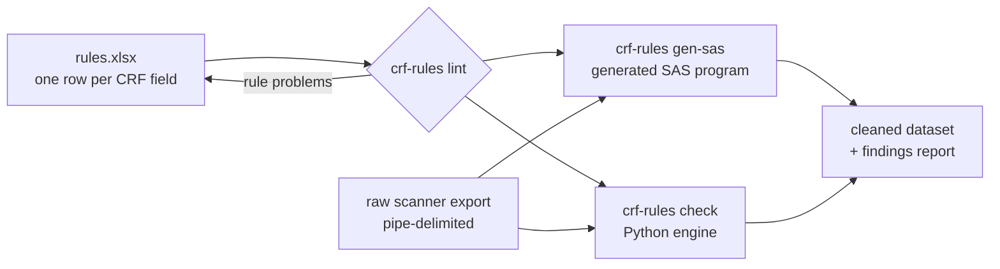

# crf-rule-engine

**Plausibility checks for clinical study questionnaires, maintained in Excel instead of code.**

Data managers describe every field of a case report form (CRF) in one Excel row: its format and a rule that a plausible value must meet. The engine turns that sheet into a complete SAS cleaning program, or runs the same checks directly in Python. The output is a typed dataset with an error count per participant and a findings report the study team can work through.

Nobody has to write or read SAS code to add a check. They add a row to the sheet.

> **Background.** I first built this as a SAS tool for the paper questionnaires of a multicentre clinical study (2025). This repository is a fresh re-implementation of the idea: a fictional study, synthetic data, and new code in Python and SAS. It contains no original study code, data or variable definitions.

---

## The problem

Paper questionnaires are scanned, and the scanner exports one text line per form. Before analysis, every field needs checking:

* Is the value in range? Was the day valid for that month?
* Did the participant tick several boxes? (The scanner codes that as `8`.)
* Do dependent answers agree? A "no" to hospital stay must not come with a hospital date. A medication flagged as taken daily needs a name.
* Is the scan date after the date the form was filled in?

Often this logic ends up hard-coded in long SAS programs with one `if` per field. Only the programmer can change it, and it is hard to review.

## The approach



The rule column uses SAS syntax, where `#` stands for the field in that row:

| variable | format | rule | message |
|---|---|---|---|
| `fu12_month` | `+"0"N(0-2)` | `# >= 1 and # <= 12` | Month missing or not between 1 and 12 |
| `fu12_health` | `+"0"N(1)` | `# in (1 2 3 4 5 6 7)` | Health rating missing, out of range or several boxes ticked (8) |
| `fu12_hosp` | `+"0"N(1)` | `(# = 0 and fu12_hosp_m = . and fu12_hosp_y = .) or # = 1` | Hospital stay missing, or 'no' although a date is given |
| `scan_date` | `YYMMDD` | `not missing(#) and # >= mdy(fu12_month, fu12_day, fu12_year)` | Scan date missing or before the date of completion |

The same rule text is used in two ways:

* **SAS:** pasted unchanged into the generated `IF` statements.
* **Python:** translated by a small, whitelisted parser that reproduces the SAS behaviour plausibility checks depend on. A missing number (`.`) is smaller than any value, `IN (8 88)` accepts space-separated lists, and `~=` means "not equal". Unknown variables, typos and anything that is not a rule are rejected, so a rules sheet cannot run arbitrary code.

The format codes come from the scanner software, for example `+"0"N(4)` for a 4-digit number or `-" "X(0-50)` for text of up to 50 characters. They drive type conversion, and they also produce format findings such as "not numeric" or "text longer than 50 characters".

## Quick start (Python)

```bash
pip install -e ".[dev]"

crf-rules lint  rules/demo_fu12_rules.xlsx                     # check the sheet itself
crf-rules check rules/demo_fu12_rules.xlsx data/demo_fu12_raw.csv -o output/
crf-rules gen-sas rules/demo_fu12_rules.xlsx -o sas/generated/demo_fu12_checks.sas
pytest
```

`output/` then contains:

* `cleaned.csv`: typed values plus `_n_errors` and `_error_vars` for each participant.
* `plausibility_report.xlsx`: three sheets.
  * `summary`: overall counts.
  * `findings`: one row per finding, with ID, variable, value, rule and message.
  * `rule_problems`: rules that could not be used.

## Quick start (SAS)

`sas/crf_rule_engine.sas` is the SAS-only path. SAS reads the Excel sheet and writes the cleaning program itself, which was the original design. See `sas/run_demo.sas`:

```sas
%include "&root./sas/crf_rule_engine.sas";
%crf_rules_to_sas(rules=&root./rules/demo_fu12_rules.xlsx, sheet=fu12_rules,
                  code=&root./sas/generated/demo_fu12_checks_from_sas.sas);
%include "&root./sas/generated/demo_fu12_checks_from_sas.sas";
%crf_clean(raw=&root./data/demo_fu12_raw.csv, outlib=work, outdir=&root./output);
```

`sas/generated/demo_fu12_checks.sas` shows the program the generator writes for the demo study, so you can read it without running anything.

## Demo study

`ACTIVE-65` is **fictional**: a 12-month follow-up questionnaire for an invented exercise trial in adults aged 65 and over. It has 25 fields and 23 rules. `scripts/make_demo_data.py` generates 300 synthetic forms with a fixed seed and deliberately breaks some of them:

* several boxes ticked
* 31 April
* age 58 in a 65+ study
* "no hospital stay" with a hospital date
* falls counted although "no fall" was ticked
* diagnosis text without a "yes"
* "taken daily" without a medication name
* 7 kg body weight
* `"ca. 5000"` in a numeric field
* a scan date before the completion date
* IDs outside the assigned range

The injected errors are listed in `data/demo_fu12_injected_errors.csv`. The tests check that the engine reports **exactly** those, with no misses and no false alarms:

| measure | value |
|---|---|
| records | 300 |
| records with findings | 54 (18 %) |
| findings | 81 (8 format, 73 rule) |
| missed / false alarms | 0 / 0 |

## Repository layout

```
rules/        demo rules sheet (fu12_rules + how_to)
data/         synthetic raw export and the list of injected errors
src/          Python package crf_rules (format parser, rule translator, engine, SAS generator, CLI)
sas/          pure SAS engine, demo runner, generated example program
scripts/      demo data generator
tests/        unit tests and end-to-end test on the demo study
_private/     not in git - local reference material only
```

## Limitations

* The rule parser covers the SAS subset that plausibility rules use:
  * comparisons, `and`/`or`/`not`, `in`/`not in` and arithmetic
  * `missing`, `coalesce`, `mdy`, `today`, `year`, `month`, `day`, `prxmatch`, `length`, `upcase`, `lowcase` and `strip`
* The raw export must list its fields in the same order as the rules sheet.
* The SAS files are not run in CI because there is no SAS licence in this repository's CI. The Python engine and the generated SAS text are covered by tests.

## Roadmap

* A browser app: drop in the rules sheet and the raw export, and get the report. The checks would run entirely client-side, so no study data leaves the computer. See [docs/browser-app.md](docs/browser-app.md).
* Rule templates for common CRF patterns: a date split into day, month and year; yes/no with a dependent date; a free-text "other" field.

## License

MIT
